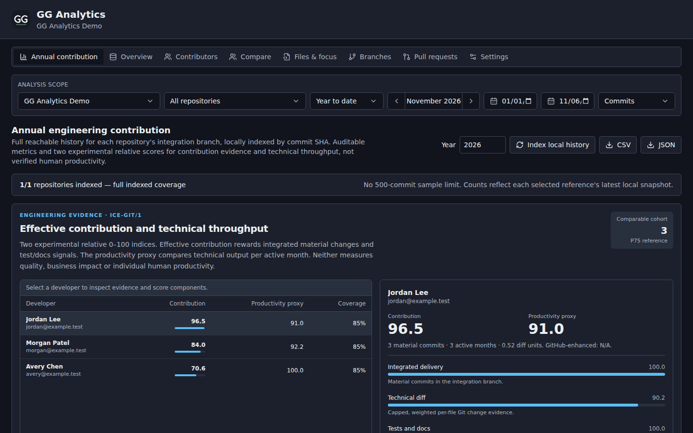
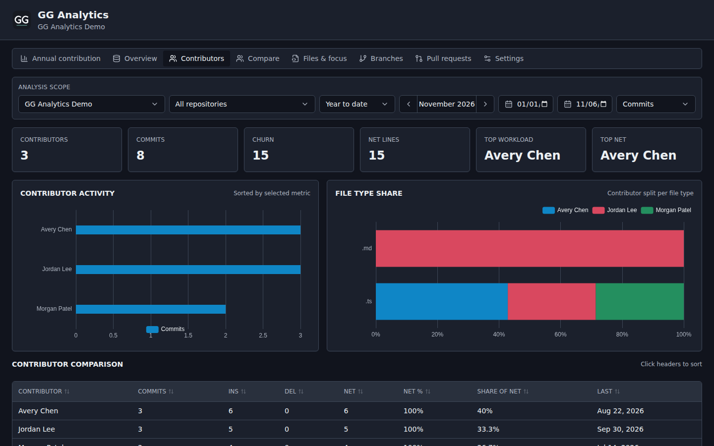
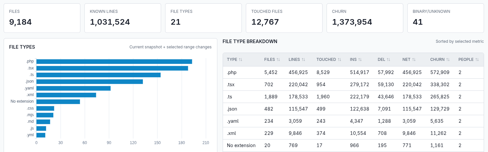

<div align="center">

# Gita

**A local-first dashboard for understanding activity, contributors, and change across Git repositories.**

[](https://nodejs.org/)
[](https://www.typescriptlang.org/)
[](https://nextjs.org/)
[](LICENSE)


</div>



Gita turns Git history into a clear engineering analytics dashboard. Group
repositories into projects, refresh their data on demand, and explore the
people and files behind every change—all from a local web application.

**Version 0.2.0 candidate:** prepared on the development branch. No tag or GitHub Release has been published.
See the [0.2.0 release notes](releases/0.2.0.md), [documentation index](docs/README.md)
and [feature catalog](docs/features/README.md).

## One dashboard for the whole project

Gita is not limited to a single repository. You can manage multiple independent
projects, attach multiple repositories to each one, and see their Git history
as one coherent product view.

- Keep backend, frontend, infrastructure, and shared-library repositories under
  the same project.
- Aggregate commits, line changes, churn, contributors, and activity across all
  repositories in that project.
- Compare repositories side by side or narrow every view to one repository
  without losing the project-level context.
- Refresh an entire project at once or update a single repository on demand.

## Understand every contributor

See who is driving activity across the project, compare commits and line-change
metrics, and understand which file types each contributor works with. Gita
normalizes Git identities so project-wide leaderboards remain useful even when
the work is split across several repositories.



## Find where change concentrates

Explore the current file landscape alongside historical change. File-type
breakdowns, touched-file counts, and churn metrics make it easier to spot the
technologies and parts of a project that absorb the most work.



## What you can explore

- Project-level analytics across multiple repositories
- Commits, insertions, deletions, net line change, and churn over time
- Contributor leaderboards, activity trends, focused comparisons of 2–4 selected developers, and custom tag filters
- Repository comparisons, branch activity, hot files, and file-type insights
- Read-only three-dot branch comparisons (ahead/behind and changed files) from
  cached Git mirrors, with a 500-file display limit and truncation notice
- Reusable branch views with per-repository folder filters
- Project-wide Branches and Pull requests tables with repository names
- Free-form custom tags and optional groups for contributors, repositories, branches and pull requests
- Dedicated Settings tab for workspace management, appearance and labels
- GitHub pull requests and branch metadata through the optional `gh` CLI
- Composable filters for repository, contributor, branch, folder, date, and
  metric

Gita is local-first and read-only toward analyzed repositories. Its database,
mirror caches, logs, and exports stay inside `.gita/` in the application
directory.

## Engineering analytics — complete annual contribution

The annual view includes **ICE-Git/1 effective contribution** and a separate
**Gita-Throughput/1 technical productivity proxy**, both relative experimental
0–100 indicators calculated from cached Git diff evidence (not objective
measurements of human performance). See [methodology](docs/ICE-GIT.md).


The **Annual contribution** tab is the first view in every Gita project.
It incorporates the complete-history, incremental annual measurement approach
from [Git Insights Dashboard 0.3.0](https://github.com/ginmp8/git-insights-dashboard/pull/1).

- **Full integration history:** select a reporting year to analyze every
  reachable SHA on each repository's integration branch, without a 500-commit
  sampling cap. Commits shared among branches in the same repository are
  counted only once.
- **Developer activity:** integrated and substantive commits, active days,
  cosmetic-only changes, test-file touches, and monthly trends.
- **Change-quality diagnostics:** gross churn, rename-aware churn,
  whitespace-adjusted churn, and source/test/docs/generated breakdowns.
- **Incremental SQLite processing:** indexes per-SHA measurements once,
  reuses the local results on later refreshes, and reconciles rebased refs
  without claiming incomplete data is complete.
- **Optional collaboration:** manually map Git author emails and GitHub
  logins; explicitly request GitHub PR/review snapshots through the GitHub
  CLI (read-only metadata is enabled by default). Missing data is not zero.
- **Local exports:** annual developer metrics in CSV or JSON.

The activity metrics and the two experimental scores are **evidence proxies,
not objective measures of productivity**. Code changes, PRs and reviews alone
do not demonstrate delivery value or engineering quality. See the detailed
[annual methodology, limitations and privacy boundaries](docs/ANNUAL-ANALYTICS.md).

## Appearance and project lifecycle

Select **Light**, **Dark**, or **System** in **Settings → Appearance**. The
preference is stored locally in your browser and includes chart colors.

A project's **Delete project and local data** control asks you to type the
project name before permanent deletion. The operation removes Gita-owned
SQLite project data, associated annual analytics and cached bare Git mirrors.
It never deletes your original local source repositories or any Git remote.
The application refuses deletion while a refresh is running or if a mirror
path fails the safety checks. Local deletion is irreversible; back up data
you want to keep.

## Saved analytics context

On first launch without stored preferences, the dashboard uses **Year to date**,
from January 1 of the current local year through today. Project, repository,
metric and date filters persist locally across tabs and app restarts. The
rolling year-to-date preset updates its end date when Gita is reopened on a
later day; an explicitly saved custom/all-time range is preserved.

The Compare tab persists the last selected contributors, year, tag and search
for each project/repository. **Select all matching** includes the complete
candidate list after current tag and search filters, without a four-person
cap. Large selections scroll instead of truncating the data. Browser
preferences use localStorage on the current app origin and are not uploaded.

Annual indexing examines all reachable commits in incremental batches, without
a 500-commit cutoff. See [annual analytics](docs/ANNUAL-ANALYTICS.md) for coverage
semantics and caching.

## Local CLI for agent harnesses

Gita exposes its cached analytics through a local **read-only JSON CLI**
for any trusted coding harness able to execute a subprocess. It does not
require an HTTP API server, authentication, network access or a separate
MCP installation.

    npm --silent run cli -- catalog
    npm --silent run cli -- projects
    npm --silent run cli -- scores --project PROJECT_ID --year 2026
    npm --silent run cli -- annual --project PROJECT_ID --year 2026
    npm --silent run cli -- table --table annual_file_changes --limit 100

The CLI includes project summaries, full annual scores and score components,
contributor and repository analytics, branch/PR inventories, tags, and
paginated raw Git/SQLite records. See
[CLI documentation](docs/features/local-cli.md) or **Settings** for
the current project command examples and database directory. A Gita source
checkout with Node.js 24 and npm ci is required; the native desktop
installer does not bundle this CLI.

## Quick start

### Requirements

- [Node.js 24](https://nodejs.org/) or newer
- npm
- [Git](https://git-scm.com/)
- [GitHub CLI](https://cli.github.com/) (optional, for GitHub metadata)

Clone or download the repository, then run:

```bash
cd gita
npm ci
npm run dev
```

Open [http://127.0.0.1:4444](http://127.0.0.1:4444) in your browser. The local
API runs at [http://127.0.0.1:4443](http://127.0.0.1:4443).

The database and required runtime directories are created automatically on
first start.

### GitHub CLI discovery and bulk registration

The **GitHub import** button in the dashboard header can list repositories you
can access with the already authenticated `gh` CLI. Listing is **explicit**,
never a side effect of opening the UI; it requires
read-only GitHub metadata access enabled by default (`GITA_ALLOW_GITHUB_METADATA=0` disables it). The picker filters by owner, visibility,
archived status and name, and can register up to **25 repositories** per
click. Listing and registration store metadata only. Click **Refresh
project** to clone their Git mirrors into the local app cache.

For private HTTPS repositories, ensure Git's configured credential helper can
authenticate; you may use `gh auth setup-git` after `gh auth login`.
The picker never reads or stores the GitHub token itself.

### Add your first repository

1. Create a project from the dashboard.
2. Add a repository using a local path, HTTPS URL, SSH URL, or GitHub shorthand
   such as `owner/repository`.
3. Select **Refresh** to analyze the repository.
4. Use the dashboard filters and tabs to explore the results.

For GitHub pull request enrichment, authenticate the optional CLI before
refreshing:

```bash
gh auth login
gh auth status
```

Core Git analytics continue to work when `gh` is missing, unauthenticated, or
temporarily unavailable. Remote clone/fetch occurs only when you explicitly
select **Refresh** for registered repositories. GitHub PR metadata remains
independently opt-in. See [Network and privacy](docs/NETWORK-PRIVACY.md).

## How it works

Gita never checks out or modifies the repositories it analyzes. Remote
repositories are cloned as bare mirrors into the app-owned `.gita/repos/`
cache; later refreshes update only those caches with `git fetch --prune`.
Provider metadata is read through the local `gh` CLI.

```text
apps/web                 Next.js dashboard
apps/api                 Fastify API and refresh worker
packages/core            Domain types and metric aggregation
packages/db              SQLite and Drizzle data layer
packages/git-engine      Safe Git execution and parsing
packages/github-adapter  Read-only GitHub integration through gh
```

The application uses TypeScript, npm workspaces, Turborepo, Next.js, Fastify,
SQLite, Drizzle ORM, Tailwind CSS, Radix UI, Apache ECharts, and TanStack Table.

## Development

```bash
npm run build       # Build every workspace
npm run test        # Run the Vitest suite
npm run lint        # Lint the codebase
npm run typecheck   # Check strict TypeScript types
npm run format      # Format with Prettier
```

Database utilities:

```bash
npm run db:generate
npm run db:migrate
npm run db:studio
```

## Metric notes

Line metrics come from Git `--numstat`: they describe historical change, not
the current size or absolute ownership of the codebase. Merge commits remain in
commit counts but are excluded from contributor line-change totals. Binary
files do not contribute line counts.

## Network and privacy

Gita analyzes source code and commit history locally. Merely opening the
dashboard does not contact Git remotes. Clicking **Refresh project** or
**Refresh repository** authorizes clone/fetch operations against the remote
URLs already registered in Gita. No extra environment variable is needed.

The app reads from remote Git servers; it does not `git push` or upload
project files to an analytics service. GitHub PR metadata queries through
`gh` remain a separate optional integration.

To force a fully offline refresh, set `GITA_OFFLINE=1` before starting Gita.
An explicit `GITA_ALLOW_REMOTE_GIT=0` also disables remote Git refreshes.
To opt into noninteractive/background Git operations in future integrations,
`GITA_ALLOW_REMOTE_GIT=1` is supported. The offline switch always wins.

Next.js CLI telemetry is disabled in the project's npm scripts. The local
Fastify API is not exposed on the Internet.

See [Network and privacy](docs/NETWORK-PRIVACY.md) for precise controls,
their scope, and limitations.

## Desktop application (Tauri 2)

The optional native desktop distribution bundles the existing React dashboard,
Fastify backend, Node.js 24 and native SQLite binding. **Node.js is not
required on the end user's machine**, but **Git must be available** to analyze
repositories; the `gh` CLI remains optional.

- [Desktop development, build, architecture and security](docs/DESKTOP.md)
- [Desktop CI artifacts and manual GitHub Releases](docs/RELEASING-DESKTOP.md)

The browser-based `npm run dev` workflow remains unchanged. Building the
desktop does not migrate SQLite or change the original analytics engine.

## Security and self-hosting

Gita is **local-first**. The API binds to `127.0.0.1:4443` by default and has
**no user authentication**. Do not publish the API directly or expose it
through an unauthenticated reverse proxy. Shared installations require an
authentication and TLS boundary.

HTTP `Host` validation also limits access to loopback hostnames by default,
reducing DNS rebinding exposure. Explicit reverse-proxy hostnames can be
added with `GITA_ALLOWED_API_HOSTS` (comma-separated). This is not
authentication and does not itself enable network listening.

Browser CORS access is restricted to `http://127.0.0.1:4444` and
`http://localhost:4444`. Operators may add extra *exact* origins through
`GITA_ALLOWED_WEB_ORIGINS` (comma-separated). CORS is **not** authorization.

HTTPS Git URLs containing userinfo or common token query parameters are
rejected by default to avoid plaintext credential storage in SQLite and Git
mirror configuration. Prefer a Git credential helper. To explicitly retain
the original behavior, set `GITA_ALLOW_URL_CREDENTIALS=1`, accepting the
credential-storage risk.

See [Security hardening](docs/SECURITY-HARDENING.md) for the verified
source scope, dependency updates, controls and remaining risks.

## License

Gita is available under the [MIT License](LICENSE). You may use, copy, fork,
modify, and distribute it, including for commercial purposes, as long as the
copyright and license notice remain included. The software is provided **as
is**, without warranty; its authors are not liable for how it is used.

---

**Suggested GitHub topics:** `git` · `git-analytics` · `repository-analytics` ·
`engineering-metrics` · `developer-tools` · `code-churn` ·
`contributor-insights` · `github-analytics` · `local-first` · `typescript` ·
`nextjs`
